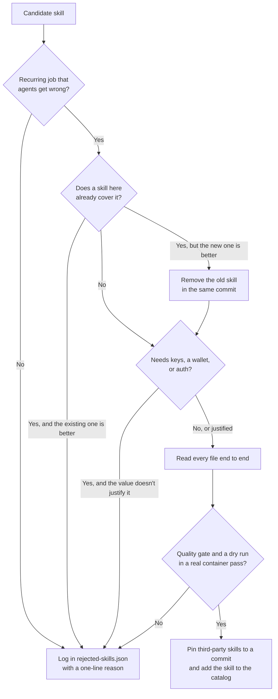

# Why these skills

The [catalog](../skills/README.md) lists the skills in this repo. This page explains why they are here, so you can judge the next addition or removal by the same standard.

## The thesis

Without guidance, an agent produces the most common answer, like a purple gradient or a fix that looks right and misses the root cause. Each skill here moves one recurring job closer to what a careful senior engineer or designer would do.

The collection stays small on purpose. A loaded skill spends tokens and attention, and it can trigger at the wrong moment. A skill belongs here only if it is worth loading on every agent we run.

## What a skill needs to get in

**It does a recurring job better.** Each skill answers work that keeps coming back. [fare-verdict](../skills/fare-verdict/) and [vercel-domain-search](../skills/vercel-domain-search/) exist because real decisions needed better evidence. When a new skill does an old one's job better, the same commit removes the old one.

**It treats taste as a capability.** Design is the largest group because agents fall back on generic design more visibly than anywhere else. The design skills divide the work like a design team. [frontend-design](../skills/frontend-design/) sets direction, [motion-craft](../skills/motion-craft/) handles animation, [no-ai-design-slop](../skills/no-ai-design-slop/) checks UI work during the build, [audit-ai-design-slop](../skills/audit-ai-design-slop/) reviews it afterward, and [extract-design-tokens](../skills/extract-design-tokens/) measures the design of a live site. [unslop](../skills/unslop/) applies the same standard to writing, and this page went through it. Making and reviewing are separate skills. [dataviz](../skills/dataviz/) builds charts and [dataviz-tufte](../skills/dataviz-tufte/) critiques them, because a reviewer catches flaws the author misses.

**It runs deterministic checks first.** [fare-verdict](../skills/fare-verdict/) computes its verdict from Google's own price data, with no model in the loop. [skill-quality-gate](../skills/skill-quality-gate/) returns the same findings for the same input. [branch-hygiene](../skills/branch-hygiene/) shows its evidence before it deletes anything. Models judge only what the checks can't decide, and an uncertain judgment goes to a person ([ADR-001](adr-001-advisory-judge-for-skill-quality-gate.md)).

**It states its limits.** [sandboxed-run](../skills/sandboxed-run/) calls itself "process hygiene, not a jail." fare-verdict does not book flights. [nothing-design](../skills/nothing-design/) runs only when you name it. The quality gate flags a skill that claims behavior it doesn't implement.

**It is safe by default.** Skills prefer reversible actions. They move files to trash instead of deleting them, classify branches before cleanup, run untrusted code without credentials, and scan for secrets before publishing. They avoid API keys where they can. A skill that needs your wallet or keys has to justify that access, and none of the Binance hub's wallet or trading skills did.

**We pin and vet third-party skills.** We vendor from people whose work we admire, including Anthropic, Cloudflare, Emil Kowalski, and MengTo. We pin each skill to a recorded commit, read it end to end, and run it once in a real container before merging. Bumping the pin repeats the whole check. We write our own skill when no upstream one is good enough.

**It keeps context small.** [caveman](../skills/caveman/) compresses replies. [handoff-context](../skills/handoff-context/) starts a new thread from a structured summary instead of the full history. Rejections follow the same rule. We turned down `find-skills` because it put 5 KB in every prompt to replace a one-line CLI call.

## How a candidate is decided

Every candidate goes through the same checks, and every no ends up in the rejection log.

## The jobs the skills cover

| Job | What it gives you | Examples |
|-----|-------------------|----------|
| Craft | Work that doesn't look or read as generated | frontend-design, no-ai-design-slop, unslop |
| Code quality | Reviews, commits, and fixes a senior engineer would approve | review-pr, systematic-debugging, skill-quality-gate |
| Risk containment | Untrusted code runs away from your credentials and working tree | sandboxed-run, security-audit, live-system-forensics |
| Live data | Answers from current sources instead of model memory | fare-verdict, meta-search, og-social-cards |
| Continuity | New sessions and containers start with the context and tools they need | handoff-context, docker-agent-browser |

## What we say no to

The [rejection log](../rejected-skills.json) is where our standards are most visible. Common reasons are a use case that is too narrow, an auth requirement that buys little, a duplicate of a better skill, or a change to agent behavior in every repo for value in a few. We log each rejection on the day we decide it, with a one-line reason, so nobody has to evaluate the same skill again.

## How the collection changes

The goal is fewer, better skills. We add a skill when agents keep getting a recurring job wrong. We re-vet a skill when its upstream changes. We retire a skill once models already know what it teaches, which is why the generic anti-slop rules left the global AGENTS.md ([ref-004](ref-004-agents-md-consolidation.md)).

One question settles most decisions. Would a thoughtful lead want this skill loaded on every agent on the team?
